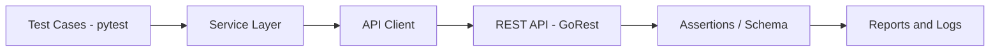
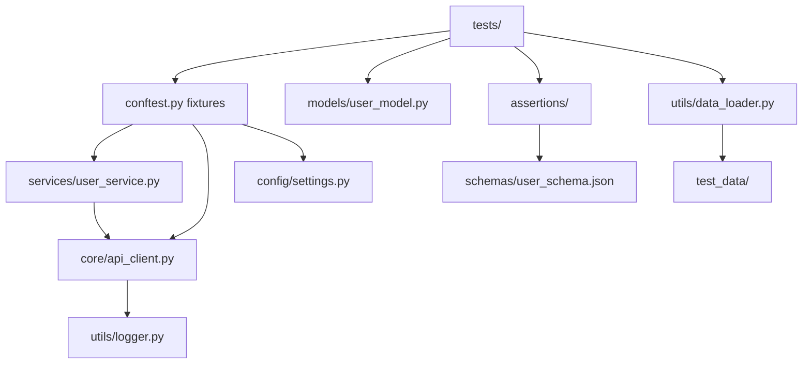
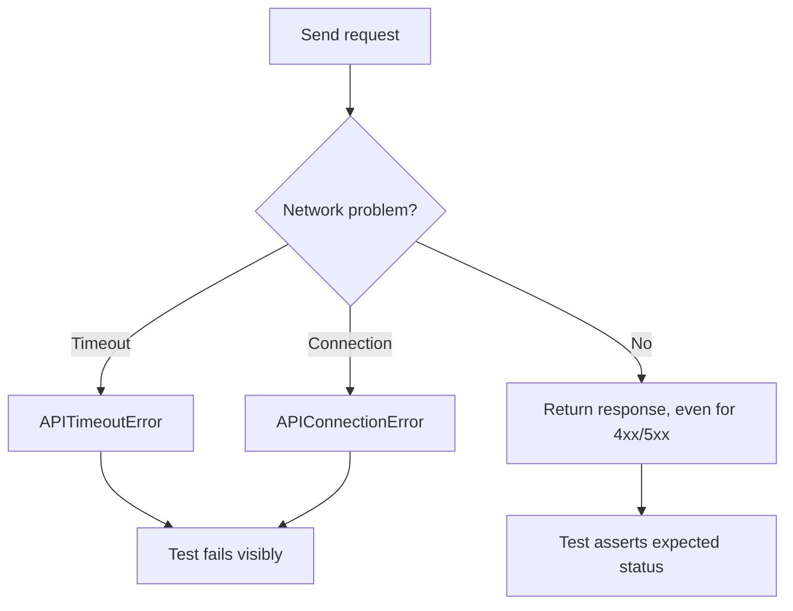

# System Design

## 1. System Architecture
The framework uses layers with one responsibility each (separation of concerns).

## 2. Component Diagram

## 3. Module Responsibilities
| Module | Responsibility | Does NOT do |
|---|---|---|
| `config/` | Environments, token, timeouts from env vars | Make requests |
| `services/` | One method per API operation; owns endpoint paths | Assert anything |
| `core/` | Send requests, log them, retry 429/5xx, wrap network errors | Assert anything |
| `models/` | Build valid unique user payloads | Call the API |
| `assertions/` | Status, JSON, fields, types, schema, time checks | Send requests |
| `utils/` | Logging, loading JSON data | Contain test logic |
| `tests/` | Define scenarios and expected results | Build raw HTTP calls |

## 4. Request Lifecycle
Test -> `user_service` fixture -> service method picks the endpoint -> `APIClient` builds URL from `base_url` + endpoint, adds headers (and Bearer token if set) -> `requests` sends -> client logs method, endpoint, status, time -> raw response returned to the test.

## 5. Response Lifecycle
Test receives response -> `assert_status_code` -> `assert_json_response` -> field/type/schema/time assertions -> pass or fail recorded by pytest.

## 6. Error Handling Flow

HTTP error statuses are not exceptions, because negative tests expect them. Network failures are raised, never swallowed. Only "try again later" statuses (429, 502, 503, 504) are retried with backoff (default 2 retries); timeouts and connection errors are not retried, so real outages stay visible.

## 7. Configuration Flow
`.env` (local, untracked) or CI secrets -> environment variables -> `get_settings()` -> `Settings` object -> `api_client` fixture. `APP_ENV` selects development / testing / production; `API_BASE_URL` overrides the URL.

## 8. Reporting Flow
pytest runs -> pytest-html writes `reports/test_report.html` -> logger writes `logs/api_tests.log` -> CI uploads both as a build artifact.

## 9. Test Data Flow
`test_data/*.json` -> `utils/data_loader.py` -> parametrized tests. The `created_user` fixture creates a real user through the API and removes it afterwards, so tests do not depend on shared data.
